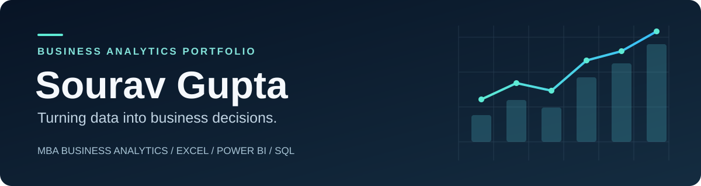

# Sourav Gupta

**MBA Business Analytics at Lovely Professional University (2026–2028) · Aspiring Business Intelligence Analyst**

[Portfolio](https://souravgupta.vercel.app/) · [Résumé](https://souravgupta.vercel.app/sourav-gupta-resume.pdf) · [LinkedIn](https://www.linkedin.com/in/souravguptaanalyst/) · [Behance](https://www.behance.net/souravgupta38)

I use Excel, SQL and Power BI to explain changes in financial performance, customer retention and delivery. My background is in marketing management and broadband customer-care operations, where I led a 12-person team and tracked service KPIs.

## Selected projects

### [Hindustan Unilever annual report analysis](https://github.com/sourav-gupta-analytics/hul-annual-report-analysis)

Compared turnover, EBITDA margins and segment performance across comparable standalone results for FY25 and FY26. The repository includes annual-report source references, financial findings, and an editable three-page Power BI Desktop report.

[Dashboard screenshots](https://github.com/sourav-gupta-analytics/hul-annual-report-analysis/tree/main/dashboard) · [Editable Power BI project](https://github.com/sourav-gupta-analytics/hul-annual-report-analysis/raw/refs/heads/main/dashboard/HUL_PowerBI_Project.zip)

### [E-commerce sales, retention and delivery intelligence](https://github.com/sourav-gupta-analytics/olist-ecommerce-bi)

Used a historical Olist dataset of 99,441 orders to analyze delivered merchandise sales, repeat purchases and delivery timeliness. The case study includes 10 reproducible SQLite reports, a Python runner and Power BI report methodology.

### [CampusDesk multilingual complaint router](projects/campusdesk/README.md)

Our team built this Code Fuzion 2026 prototype at LPU to route English, Hinglish and romanized Punjabi complaints with a human review workflow. The documented benchmark covers 180 known synthetic examples. Eight automated tests passed in a rerun against the project source. Performance on unseen complaints remains unverified.

[Live prototype](https://hinglish-complaint-router.netlify.app/)

## Skills and credentials

- **Excel and Power BI:** financial benchmarking, dashboard design and business reporting.
- **SQL and Python:** SQLite analysis, repeatable reports and data validation.
- **Professional development:** Microsoft and LinkedIn Career Essentials in Data Analysis, LinkedIn Learning courses in business analysis, and the EY AI Series. [View certificate evidence](https://souravgupta.vercel.app/#certifications)

## Education and experience

- **MBA, Business Analytics** at Lovely Professional University, Punjab, 2026–2028.
- **BBA, Marketing Management** at Devi Ahilya Vishwavidyalaya, Indore.
- **Team Leader, broadband customer care** at Altruist Technologies Pvt Ltd, Indore.
- **Social Media Management Intern** at Shark Outreach. [View experience](https://souravgupta.vercel.app/#experience)

I’m interested in BI and business analytics internships. My next priorities are to document individual project contributions more clearly and validate CampusDesk on new examples. [Connect on LinkedIn](https://www.linkedin.com/in/souravguptaanalyst/)
